<!-- Custom Xianxia Ink-Wash Hero Banner -->

 

<!-- Animated Poetic Motto -->

 

 

  

 

<!-- About & Realm (2-Column Scroll Layout) -->
<table>
  <tr>
    <td width="56%" valign="top">
      <h3>道 · About Me</h3>
      

        Hi, I'm <b>ALEXIOS</b> (<code>@bkzz4444</code>) — a developer crafting sleek mobile apps, practical Python tools, and atmospheric 3D WebGL / anime visual experiences.
      

      <ul>
        <li><b>Mobile Realm:</b> Cross-platform apps with <b>Flutter</b> &amp; <b>Dart</b></li>
        <li><b>Script Realm:</b> Automation &amp; utilities with <b>Python</b></li>
        <li><b>Visual Realm:</b> Custom <b>Three.js / GLSL Shaders</b> &amp; minimal <b>SVG</b> art</li>
      </ul>
    </td>
    <td width="44%" valign="top">
      <h3>境 · Cultivation Stack</h3>
      

        <b>Core Disciplines</b> 
        <code>Python</code> · <code>Flutter</code> · <code>Dart</code>
      

      

        <b>Visual Arts &amp; Web</b> 
        <code>Three.js</code> · <code>GLSL</code> · <code>HTML5</code> · <code>CSS3</code> · <code>SVG</code>
      

      

        <b>Current Focus</b> 
        Dark-mode UI craftsmanship &amp; interactive 3D graphics
      

    </td>
  </tr>
</table>

 

  

 

<!-- Tech Arsenal -->

  <h3>器 · Tech Arsenal</h3>
   
  

 

  

 

<!-- Featured Creations -->

  <h3>作 · Featured Creations</h3>

<table>
  <tr>
    <td width="46%" align="center">
      
    </td>
    <td width="54%" valign="middle">
      <h4><a href="https://github.com/bkzz4444/3d-keyboard-portfolio">3d-keyboard-portfolio</a></h4>
      

        Interactive <b>3D Mechanical Keycap Portfolio</b> built with Three.js, glossy 3D rounded keycaps, Web Audio API mechanical switch click SFX, and scroll-driven 3D choreography.
      

      

        <code>Three.js</code> · <code>WebGL</code> · <code>Web Audio API</code> · <code>HTML/CSS</code>
      

      

        
        &nbsp;
        
      

    </td>
  </tr>
  <tr>
    <td width="46%" align="center">
      
    </td>
    <td width="54%" valign="middle">
      <h4><a href="https://github.com/bkzz4444/gojo-hollow-purple">gojo-hollow-purple</a></h4>
      

        Interactive <b>3D WebGL Gojo Satoru</b> experience featuring <b>Unlimited Void</b> (3D Black Hole + Accretion Disk), <b>Lapse: Blue</b>, <b>Reversal: Red</b>, and <b>Hollow Purple</b> with Custom GLSL Shaders &amp; HDR Bloom.
      

      

        <code>Three.js</code> · <code>WebGL</code> · <code>GLSL</code> · <code>SVG</code>
      

      

        
        &nbsp;
        
      

    </td>
  </tr>
  <tr>
    <td width="46%" align="center">
      
    </td>
    <td width="54%" valign="middle">
      <h4><a href="https://github.com/bkzz4444/sharingan-evolution">sharingan-evolution</a></h4>
      

        Ultra-clean, zero-dependency <b>6-stage Uchiha Dōjutsu Loading Animation</b> evolving from 1-Tomoe Sharingan through Mangekyō, Eternal Mangekyō, to Rinnegan.
      

      

        <code>HTML5</code> · <code>CSS3</code> · <code>SVG</code> · <code>JavaScript</code>
      

      

        
        &nbsp;
        
      

    </td>
  </tr>
</table>

 

  

 

<!-- GitHub Records -->

  <h3>錄 · GitHub Records</h3>
   
  
  

 

<!-- Custom Xianxia Footer -->

  

